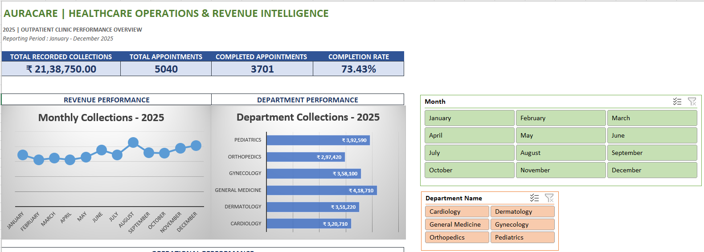
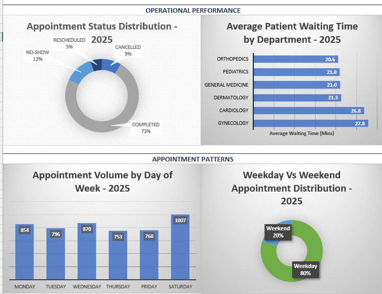

# AuraCare — Healthcare Operations & Revenue Intelligence

**An Excel-based healthcare analytics project | 2025**

AuraCare is a simulated multispecialty outpatient clinic analytics project developed using synthetic healthcare operations data. The project explores appointment management, patient waiting times, doctor workload, department performance, recorded collections, and expense transactions.

The objective is to transform raw operational datasets into meaningful business insights using Microsoft Excel, Power Query, data modelling, DAX, PivotTables, interactive dashboards, and financial What-If analysis.

> **Disclaimer:** AuraCare is an independent portfolio project built entirely with synthetic data. It is not affiliated with Apollo Clinic or any other healthcare provider and does not contain actual patient or organisational records.

---

## 1. Project Objectives

The project aims to demonstrate how data analytics can support operational monitoring and management decision-making in a healthcare environment.

Key objectives include:

- Analyse outpatient appointment volumes and appointment outcomes.
- Evaluate patient waiting times and doctor workload.
- Compare recorded collections across departments and doctors.
- Examine monthly collection trends and appointment patterns.
- Analyse recorded expense transactions by category and department.
- Explore transaction-based departmental financial performance.
- Build an interactive management dashboard.
- Simulate financial outcomes under different appointment growth and completion-rate assumptions.
- Use Excel optimisation tools to evaluate a minimum appointment growth requirement against a collection target.

---

## 2. Tools & Technologies

| Tool / Feature | Application |
|---|---|
| Microsoft Excel | Analysis, calculations, reporting and dashboard development |
| Power Query | Data cleaning, transformation and ETL |
| Excel Data Model | Relational data modelling |
| Power Pivot & DAX | Custom analytical measures |
| PivotTables | Operational and financial analysis |
| PivotCharts | Data visualisation |
| Excel Slicers | Interactive filtering |
| Scenario Manager | Scenario-based financial simulation |
| Two-Variable Data Tables | Sensitivity analysis |
| Goal Seek | Target-based calculation |
| Solver | Appointment growth optimisation |

---

## 3. Dataset Overview

The project uses five synthetic CSV datasets representing outpatient clinic operations during January–December 2025.

| Dataset | Records | Description |
|---|---:|---|
| Appointments | 5,040 | Appointment details, status, doctor, department, waiting time and payment information |
| Doctors | 18 | Doctor profiles and employment information |
| Departments | 6 | Department details and monthly operating cost baselines |
| Expenses | 189 | Recorded expense transactions |
| Operating Calendar | 365 | Daily calendar information, including weekdays, weekends and public holidays |

### Dataset Scope

- Reporting period: 1 January – 31 December 2025
- Appointment records: 5,040
- Doctors: 18
- Departments: 6
- Recorded expense transactions: 189
- Total datasets: 5

All records are synthetic and intended exclusively for analytical and educational purposes.

---

## 4. Data Preparation & Transformation

Power Query was used to prepare the raw datasets for analysis.

Key transformation steps included:

- Standardising text values and category labels.
- Trimming unnecessary spaces and cleaning text fields.
- Correcting column data types.
- Validating unique identifiers and checking duplicates.
- Examining missing values and unusual records.
- Creating a cleaned waiting-time field.
- Correcting weekend classification while preserving the original field.
- Retaining original source fields where appropriate for transparency.

### Data Quality Considerations

- Seven negative waiting-time records were excluded from the cleaned waiting-time calculation by replacing their cleaned values with null.
- Missing waiting-time values were retained rather than artificially imputed.
- Missing payment-method values were preserved.
- Consultation duration was unavailable for non-completed appointments.
- The original weekend classification was preserved alongside a corrected field identifying both Saturdays and Sundays.

The transformations were designed to improve analytical consistency without silently changing the underlying source records.

---

## 5. Data Modelling

All five datasets were loaded into the Excel Data Model.

Five one-to-many relationships were established:

1. Departments → Appointments
2. Doctors → Appointments
3. Operating Calendar → Appointments
4. Departments → Expenses
5. Operating Calendar → Expenses

This relational structure enabled analysis across appointment, doctor, department, calendar and expense dimensions without relying on manually combined datasets.

---

## 6. Business Analysis

Ten dedicated analytical worksheets were developed.

| Worksheet | Analysis |
|---|---|
| 01_Revenue_Analysis | Appointment volumes, recorded collections and appointment outcomes |
| 02_Department_Analysis | Department-wise recorded collections and contribution |
| 03_Monthly_Analysis | Monthly collection trends |
| 04_Doctor_Analysis | Doctor-level appointments, collections and waiting times |
| 05_Doctor_Workload | Completed appointment volumes by doctor |
| 06_Doctor_Collections | Doctor-wise recorded collections |
| 07_Department_Profitability | Departmental recorded collections, expenses and transaction-based surplus |
| 08_Expense_Analysis | Expense category distribution |
| 09_Department_Expense_Analysis | Department-wise recorded expenses |
| 10_Operational_Performance | Waiting times, appointment status and appointment patterns |

### Key Business Findings

**Appointment Performance**

- Total appointments: 5,040
- Completed appointments: 3,701
- Completion rate: 73.43%
- Cancelled appointments: 434
- No-show appointments: 645
- Rescheduled appointments: 260

**Recorded Collections**

- Total recorded collections: ₹21,38,750
- Average collection per completed appointment: approximately ₹578.
- General Medicine recorded the highest departmental collections at ₹4,18,710.
- Orthopedics recorded the lowest departmental collections at ₹2,97,420.
- August recorded the highest monthly collections at ₹2,12,950.
- April recorded the lowest monthly collections at ₹1,55,630.

**Doctor Performance**

- Dr. Arvind Kulkarni recorded the highest number of completed appointments: 386.
- Dr. Kavita Sharma recorded the highest doctor-wise collections: ₹2,27,370.
- Dr. Rakesh Menon recorded the highest average collection per completed appointment: ₹1,093.
- Overall average patient waiting time was approximately 22.5 minutes.

**Operational Performance**

- Gynaecology recorded the highest average waiting time at approximately 27.8 minutes.
- Orthopedics recorded the lowest average waiting time at approximately 20.6 minutes.
- Saturday recorded the highest appointment volume, with 1,007 appointments.
- Thursday recorded the lowest appointment volume, with 753 appointments.
- The dataset contained no recorded Sunday appointments.

**Expense Analysis**

Total recorded expenses: ₹20,81,380.

| Expense Category | Recorded Amount | Contribution |
|---|---:|---:|
| Staff Salaries | ₹13,40,900 | 64.42% |
| Supplies | ₹4,83,850 | 23.25% |
| Equipment | ₹1,26,140 | 6.06% |
| Utilities | ₹78,430 | 3.77% |
| Other | ₹30,780 | 1.48% |
| Maintenance | ₹21,280 | 1.02% |

Staff salaries and supplies together accounted for 87.67% of recorded expense transactions.

---

## 7. Financial Analysis & DAX

Custom DAX measures were developed to compare recorded appointment collections against recorded expense transactions.

### Transaction-Based Surplus

```DAX
Transaction-Based Surplus =
SUM(Appointments[Amount_Paid])
-
SUM(Expenses[Expense_Amount])
```

### Transaction-Based Margin

```DAX
Transaction-Based Margin =
DIVIDE(
    [Transaction-Based Surplus],
    SUM(Appointments[Amount_Paid]),
    0
)
```

### Departmental Results

| Department | Transaction-Based Surplus |
|---|---:|
| Cardiology | -₹1,64,150 |
| Dermatology | ₹1,16,190 |
| General Medicine | ₹1,13,120 |
| Gynaecology | ₹25,510 |
| Orthopedics | -₹1,21,710 |
| Pediatrics | ₹88,410 |
| **Overall** | **₹57,370** |

The overall transaction-based margin was approximately 2.68%.

**Financial interpretation and limitation:**

These figures represent the difference between recorded appointment collections and recorded expense transactions. They should not be interpreted as audited profit, net income or complete departmental profitability.

The Departments dataset also contains monthly operating cost baselines. Their relationship to the recorded expense transactions has not been established, so these figures have deliberately been kept separate and excluded from the transaction-based surplus calculation.

---

## 8. What-If Analysis & Financial Simulator

A formula-driven financial simulator was developed in Excel to explore how appointment growth and completion rates could influence projected collections.

### Simulation Inputs

- Current appointment volume
- Average collection per completed appointment
- Target appointment growth
- Target completion rate

### Projected Outputs

- Projected appointment volume
- Projected completed appointments
- Projected collections
- Projected collection increase
- Projected collection growth

### Native Excel What-If Tools

The project also incorporates Excel's built-in analytical tools:

**Scenario Manager**

Three scenarios were developed:

| Scenario | Appointment Growth | Completion Rate |
|---|---:|---:|
| Conservative | 5% | 70% |
| Expected | 10% | 80% |
| Optimistic | 15% | 90% |

**Two-Variable Data Table**

A 4 × 4 sensitivity analysis was created to evaluate projected collections across different appointment growth and completion-rate combinations.

- Appointment growth assumptions: 5%, 10%, 15%, 20%.
- Completion-rate assumptions: 60%, 70%, 80%, 90%.

**Goal Seek**

Goal Seek was used to identify the appointment growth required to reach a projected collection target of ₹25,00,000 while keeping the completion rate at 80%.

**Solver**

Solver was configured to minimise appointment growth while maintaining projected collections of at least ₹25,00,000, with a non-negative growth constraint.

The resulting displayed optimised appointment growth was approximately 7.29%.

These outputs are scenario-based projections, not guaranteed business outcomes.

---

## 9. Interactive Management Dashboard

The management dashboard consolidates key operational and financial indicators into a single Excel reporting interface.

### Dashboard Features

- Four KPI cards:
  - Total Recorded Collections
  - Total Appointments
  - Completed Appointments
  - Completion Rate
- Monthly collections trend.
- Department-wise collections.
- Appointment status distribution.
- Average patient waiting time by department.
- Appointment volume by day of the week.
- Weekday versus weekend appointment distribution.
- Interactive Month slicer.
- Interactive Department slicer.

The dashboard supports combined filtering by month and department, allowing users to explore different operational segments.

The KPI cards retain the full-year baseline figures, while the analytical charts respond to the slicer selections.

### Dashboard Screenshots

**Dashboard Overview**



**Operational Performance & Appointment Patterns**



---

## 10. Project Structure

```text
AuraCare_Healthcare_Operations_Intelligence/
│
├── Appointments_Updated.csv
│
├── 01_Raw_Data/
│   ├── Doctors.csv
│   ├── Departments.csv
│   ├── Expenses.csv
│   └── Operating_Calendar.csv
│
├── 02_Excel_Workbook/
│   └── AuraCare_Operations_Intelligence.xlsx
│
├── 03_Documentation/
│
├── 04_Dashboard_Exports/
│   ├── dashboard_overview.png
│   └── dashboard_operational_performance.png
│
└── README.md
```

---

## 11. Key Skills Demonstrated

- Data cleaning and transformation using Power Query.
- Relational data modelling using Excel Data Model.
- Analytical calculations and custom DAX measures.
- Healthcare operations and revenue analysis.
- Financial and expense analysis.
- PivotTable and PivotChart development.
- Interactive dashboard design.
- Scenario planning and sensitivity analysis.
- Goal-based optimisation using Goal Seek and Solver.
- Business insight generation and analytical reporting.

---

## 12. Limitations & Assumptions

- All datasets are synthetic and do not represent an actual healthcare organisation.
- Recorded collections represent the `Amount_Paid` field in completed appointment records, not necessarily billed revenue or accounting-recognised revenue.
- Recorded expense transactions may not represent all operating costs.
- Departmental transaction-based surplus is not equivalent to audited profit.
- Monthly operating cost baselines have not been reconciled with recorded expense transactions.
- Projected financial results depend on the assumptions entered into the simulator.
- The absence of Sunday appointments does not establish that the clinic was officially closed on Sundays.
- No clinical outcomes, diagnoses or treatment effectiveness are evaluated.

---

## 13. Project Deliverables

The repository includes:

- Original synthetic CSV datasets.
- Excel workbook containing transformed data and the Data Model.
- Ten analytical worksheets.
- Formula-driven financial simulator.
- Scenario Manager summary.
- Two-variable sensitivity analysis.
- Goal Seek and Solver optimisation results.
- Interactive management dashboard.
- Dashboard screenshots and supporting documentation.

---

## 14. Conclusion

AuraCare demonstrates an end-to-end Excel-based analytics workflow in a simulated healthcare operations environment.

By combining data preparation, relational modelling, business analysis, financial simulation and interactive visualisation, the project illustrates how structured data can be transformed into actionable operational insights.

**Project Category:** Healthcare Analytics | Business Intelligence | Excel Portfolio Project

**Reporting Period:** January–December 2025